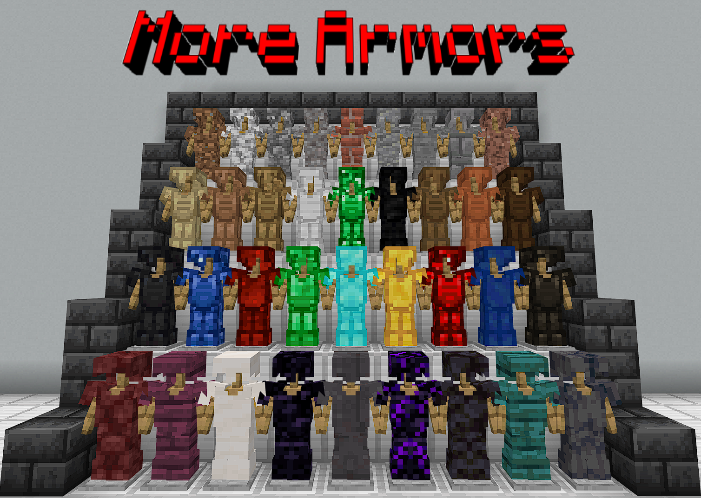

# 更多盔甲 · More Armors（Laoqi 更新版 v2.6）

**简体中文** ｜ [English version](README_EN.md)

> 基于 **Drag504** 的 **More Armors v2.2（Nether Update）** 重制

> 封面图：原模组 More Armors 的官方图（by Drag504）

一个给 Minecraft 基岩版（Bedrock）添加 **36 套、共 144 件**全新盔甲的模组。原作者 Drag504 的作品已经很多年没有维护，在新版基岩版里已经完全无法使用 —— **装上去一件装备都不会出现**。这个 v2.6 版本把它整修好并跟进了新版。

**下载**：直接下载本仓库里的 [`More Armors.mcaddon`](More%20Armors.mcaddon)（一个文件搞定），或者分开的 [`MoreArmorsBP.mcpack`](MoreArmorsBP.mcpack) / [`MoreArmorsRP.mcpack`](MoreArmorsRP.mcpack)。安装方法见下方「安装」。

---

## 一个爸爸的小故事

我 5 岁的儿子在视频里看到这个模组，吵着要装。

结果我折腾了很久：包是装上了，游戏里却一件装备都不出现，整套模组等于完全没生效。一度非常抓狂。

最后我用 **deepseek v4 flash high** 配合 codex，两个小时就把问题全部查清并修好了（物品格式、护甲判定、图标、配方、双语名称……）—— 一共只花了两块六毛钱。

这份更新是为我可爱的儿子做的，也送给所有喜欢 Minecraft 的网友。祝你们玩得开心。

---

## 这次更新做了什么

- **让整套装备在新版重新可用**：原版在新版上「装了等于没装」—— 物品数据格式已经失效，144 件装备一件都不会出现
- **物品、护甲、附魔、配方的数据格式全部按新版重写**
- **修掉两个致命字段**：胸甲的附魔槽被写成了非法值（`armor_chest`），会让整件物品被游戏丢弃；旧的图标写法在新版会显示成空白图标
- **穿在身上的外观**：恢复正常（旧版的几何体命名在新版已失效）
- **套装效果修正**：原来「钻石块 / 下界合金块 穿齐四件」的判定写错了（实际只判定靴子），现在是真的四件齐全才触发
- **中英双语名称**：跟随游戏语言自动切换；与原版同类材料（铁 / 金 / 钻石 / 下界合金）的套装加了 **【模组】/ `[MOD]`** 标记，方便和原版盔甲区分
- **署名简化**：原作者信息简化为「基于 Drag504 的 More Armors v2.2 重制」，更新者署名 **Laoqi**

## 内容一览

36 套 × 4 件（头盔 / 胸甲 / 护腿 / 靴子）= **144 件**，配方沿用原作者的思路（用材料或矿物块合成）：

| 类别 | 套装 |
|---|---|
| 木头 | 橡木、云杉、白桦、丛林、金合欢、深色橡木、绯红、诡异 |
| 石头 | 石头、圆石、石砖、安山岩、闪长岩、花岗岩、沙砾、泥土、红砖 |
| 矿物 | 煤炭、煤炭块、木炭、铁块、金块、钻石块、绿宝石、绿宝石块、青金石、青金石块、红石、红石块、石英 |
| 下界 | 玄武岩、黑石、黑曜石、哭泣的黑曜石、下界岩、下界合金块 |

其中 **钻石块** 和 **下界合金块** 是「顶配」两套：穿齐四件会获得 抗性提升 / 生命恢复 / 力量（手持对应的剑再加力量），下界合金块还多一条 防火。数值上，方块系列普遍比原版同类材料的盔甲更强、更耐久。

## 安装

**要求**：Minecraft 基岩版 **1.21 及以上**（已在当前最新版实测通过）

**方式一（推荐）**：双击 `More Armors.mcaddon`，游戏会自动导入。

**方式二（手动，双击没反应时用这个）**：

1. 把 `More Armors.mcaddon` 改名成 `.zip` 解压，得到 `More Armors BP` 和 `More Armors RP` 两个文件夹；
2. 打开 `com.mojang` 目录，二选一（哪个存在用哪个）：
   - 新版启动器 / GDK 版：`%APPDATA%\Minecraft Bedrock\Users\Shared\games\com.mojang`
   - 商店版：`%LOCALAPPDATA%\Packages\Microsoft.MinecraftUWP_8wekyb3d8bbwe\LocalState\games\com.mojang`

   （找不到就在电脑上搜索 `minecraftWorlds` 文件夹，它的上一级就是 `com.mojang`）
3. `More Armors BP` → 复制进 `behavior_packs\`；`More Armors RP` → 复制进 `resource_packs\`；
4. 重开游戏 → 编辑世界 → 行为包 / 资源包 → 我的包 → 勾选 **More Armors**。

也可以分开导入：`MoreArmorsBP.mcpack` 和 `MoreArmorsRP.mcpack`。

**老存档可以用**：本版沿用原作者的命名空间和 UUID，导入新版会直接替换旧包，存档里已经做出来的装备不会丢失。

## 使用注意事项（重要）

- **一定要在存档里启用**：编辑世界 → 行为包 / 资源包 → 我的包 → 勾选 **More Armors**。
  ⚠️ **不要在游戏主菜单的「我的包」里单独启用**：行为包和资源包是**互相依赖**的（BP ↔ RP），全局单独启用会一直提示"缺少依赖"，看起来像坏了一样；在世界里两个一起启用就不会报错。
- **实验性玩法**：原作者要求开启世界设置里的实验性玩法（假日创作者功能 / Holiday Creator Features）。1.21+ 里自定义物品已经是正式功能，理论上不再需要，但我们没有逐一验证 —— 如果启用后物品没出现，先看看世界设置里有没有实验性开关并把它打开（新版可能已经移除了这个开关，看不到就说明不需要）。
- 启用资源包 / 行为包后，建议**退出世界重进一次**，让物品和贴图重新加载。
- 作者本人其实**不玩这个游戏**（这份更新是为儿子修的），以上都是实际踩坑总结出来的，遇到和描述不一样的情况欢迎反馈。

## 语言

名称跟随游戏语言自动切换：简体中文环境下显示「铁块头盔」「钻石块胸甲」这样的中文名，English 环境下显示 `[MOD] Iron Block Helmet` 等英文名。与原版同类材料的 4 套（铁块 / 金块 / 钻石块 / 下界合金块）名称前带 **【模组】/`[MOD]`** 标记。

## 已知限制

- 基岩版目前**没有**为自定义盔甲开放「盔甲韧性」和「击退抗性」的数据接口（原版钻石甲、下界合金甲的这两项属性是写死在游戏里的），所以自定义盔甲拿不到这两项。本模组用更高的护甲值和套装效果来弥补。
- 作者主要在创造模式做验证，生存流程（工作台合成、铁砧修复、附魔台）没有逐一实测，遇到问题欢迎反馈。

## 致谢与分享

- 原模组：**More Armors v2.2 (Nether Update)** by **Drag504** —— 感谢原作者留下的作品
- 新版适配与更新：**Laoqi**（使用 **deepseek v4 flash high** 配合 codex）
- **许可**：本项目以 **MIT** 协议开源（见 [LICENSE](LICENSE)）；原模组 More Armors 及其素材的版权仍归原作者 Drag504 所有
- 转发时建议保留原作者与本更新的署名

祝你玩得开心，也欢迎把发现的问题告诉我。

---

**English version**: [README_EN.md](README_EN.md)
